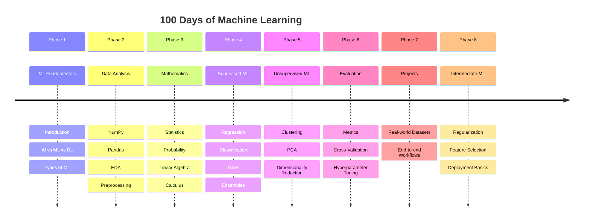

<div align="center">
  
</div>

<div align="center">
  <a href="https://git.io/typing-svg">
    
  </a>
</div>

<div align="center">
  
</div>

<br/>

<div align="center">
  <a href="https://www.linkedin.com/in/muhammadabubakar147/">
    
  </a>&nbsp;

  <a href="mailto:YOUR_EMAIL@gmail.com">
    
  </a>&nbsp;

  <a href="https://github.com/Muhammad-Abubakar147">
    
  </a>
</div>

<div align="center">

```
███╗   ███╗      █████╗ ██████╗ ██╗   ██╗██████╗  █████╗ ██╗  ██╗ █████╗ ██████╗ 
████╗ ████║     ██╔══██╗██╔══██╗██║   ██║██╔══██╗██╔══██╗██║ ██╔╝██╔══██╗██╔══██╗
██╔████╔██║     ███████║██████╔╝██║   ██║██████╔╝███████║█████╔╝ ███████║██████╔╝
██║╚██╔╝██║     ██╔══██║██╔══██╗██║   ██║██╔══██╗██╔══██║██╔═██╗ ██╔══██║██╔══██╗
██║ ╚═╝ ██║     ██║  ██║██████╔╝╚██████╔╝██████╔╝██║  ██║██║  ██╗██║  ██║██║  ██║
╚═╝     ╚═╝     ╚═╝  ╚═╝╚═════╝  ╚═════╝ ╚═════╝ ╚═╝  ╚═╝╚═╝  ╚═╝╚═╝  ╚═╝╚═╝  ╚═╝
```


<h1 align="left"> <a href="https://github.com/arhamansari11/"> </a>IAM MUHAMMAD ABUBAKAR</h1>
</a>
<h1 align="center">📊 NumPy Project Repository</h1>

  <h2><i>⚙️ GitHub Analytics</i></h2>

<p align="center">
<a href="https://github.com/Muhammad-Abubakar147">
  
  
<p align="left">
 
</p>
</a>

<div align="center">


<div align="center">

---

## 🚀 Let’s Build Something Amazing Together


---

### 🌐 Connect With Me

[]()
[]()
[]()
[]()

---

### ⭐ Support My Work

**If you like my projects, consider giving a star ⭐ to my repositories — it keeps me motivated!**


</div>
## 📈 GitHub Contribution Graph

<div align="center">

[](https://github.com/Muhammad-Abubakar147)

</div>

---
### Machine Learning
<a href="https://github.com/arhamansari11/">
<div align="center">
        
</div>
</a>
</td><td valign="top" width="25%">

### Frontend  
<a href="https://github.com/arhamansari11/">
<div align="center">  
        
</div>
</a>
 </td><td valign="top" width="25%">
        
### Backend
<a href="https://github.com/arhamansari11/">
<div align="center">
        
</div>
</a>


<p align="center">     </p>

<p align="center"> <b>A complete collection of my Python classes, experiments, practice, and programming concepts.</b> </p>

<p align="center"> <i>Learn the concept → Write the code → Break the code → Understand the logic → Build again.</i> </p>


<!--## 📸 Projects

<div align="center">

| Open cv Project |Python calculator  |Machine learning project |
|:---:|:---:|:---:|
|  |  |  |

| 🤖 Project 4 | 📊 Project 5 | 🐍 Project 6 |
|:---:|:---:|:---:|
|  |  |  |

| 🎯 Project 7 | 🌐 Project 8 | 🧠 Project 9 |
|:---:|:---:|:---:|
|  |  |  |

</div> -->

---

## 🚀 Featured Projects

<div align="center">

| 🛍️ **Ibbi's Collection** | 👁️ **Face Detection** | 🐾 **Zoo Classification** |
|:---:|:---:|:---:|
|  |  |  |
| A modern e-commerce website built with HTML, CSS & JavaScript. | Real-time face, eyes & smile detection using OpenCV. | Animal data analysis and classification project using Python. |
| [👀 View Project](PROJECT_LINK_1) | [👀 View Project](PROJECT_LINK_2) | [👀 View Project](PROJECT_LINK_3) |

| 🤖 **Machine Learning** | 📊 **Data Analysis** | 🐍 **Python Project** |
|:---:|:---:|:---:|
|  |  |  |
| Machine learning experiments covering preprocessing and model building. | Data exploration and visualization using Pandas, NumPy & Matplotlib. | Python-based project focused on programming and problem solving. |
| [👀 View Project](PROJECT_LINK_4) | [👀 View Project](PROJECT_LINK_5) | [👀 View Project](PROJECT_LINK_6) |

| 🎯 **Computer Vision** | 🌐 **Portfolio Website** | 🧠 **AI / ML Project** |
|:---:|:---:|:---:|
|  |  |  |
| Computer vision project using OpenCV for real-world visual tasks. | Personal developer portfolio showcasing skills, projects & achievements. | AI/ML project exploring intelligent solutions with Python. |
| [👀 View Project](PROJECT_LINK_7) | [👀 View Project](PROJECT_LINK_8) | [👀 View Project](PROJECT_LINK_9) |

</div>

---


```markdown
<div align="center">

# 🤖 Machine Learning

### 100 Days of Machine Learning — A Structured Journey from Fundamentals to Practical Projects

[](https://www.python.org/)
[](https://numpy.org/)
[](https://pandas.pydata.org/)
[](https://scikit-learn.org/)
[](https://jupyter.org/)
[](https://colab.research.google.com/)
[](https://git-scm.com/)
[](https://github.com/)

[](https://github.com/Muhammad-Abubakar147/Machine-Learning)
[](https://github.com/Muhammad-Abubakar147/Machine-Learning)
[](https://github.com/Muhammad-Abubakar147/Machine-Learning)
[](https://github.com/Muhammad-Abubakar147/Machine-Learning)

[](https://github.com/Muhammad-Abubakar147)
[](https://github.com/Muhammad-Abubakar147/Machine-Learning/stargazers)
[](https://github.com/Muhammad-Abubakar147/Machine-Learning/network/members)
[](https://github.com/Muhammad-Abubakar147/Machine-Learning/issues)

</div>

---

## 📌 About This Repository

**Machine-Learning** is a structured **100-day learning repository** created to build a strong foundation in Machine Learning through consistent study, hands-on Python implementation, and practical experimentation.

This repository documents my journey from core Machine Learning concepts to data analysis, preprocessing, algorithms, model evaluation, and real-world projects. It is designed to demonstrate steady technical growth, disciplined learning, and the ability to apply Machine Learning concepts using Python.

I started this challenge to move beyond theory and develop practical skills in:

- Understanding how Machine Learning systems work.
- Analyzing and preparing real-world datasets.
- Implementing Machine Learning algorithms from scratch and with libraries.
- Building, evaluating, and improving models.
- Developing a strong foundation for future work as a Machine Learning Engineer.

The repository will continue to grow as I complete new days, concepts, notebooks, and projects. Only topics that are present in this repository are marked as completed.

---

## 🎯 Learning Objectives

By the end of this journey, I aim to:

- Understand the mathematical and statistical foundations of Machine Learning.
- Work confidently with Python, NumPy, Pandas, Matplotlib, and Seaborn.
- Perform data cleaning, exploratory data analysis, and feature engineering.
- Implement supervised and unsupervised Machine Learning algorithms.
- Evaluate models using appropriate metrics and validation techniques.
- Identify and address overfitting, underfitting, bias, variance, and data leakage.
- Build end-to-end Machine Learning workflows and practical projects.
- Develop a portfolio that reflects consistent learning and practical implementation.

---

## 🛠️ Technologies and Tools

### Currently Used

| Technology | Purpose |
|---|---|
| **Python** | Core programming language for Machine Learning implementation |
| **Jupyter Notebook** | Interactive learning, experimentation, and documentation |
| **Google Colab** | Cloud-based notebook environment for coding and analysis |
| **Git** | Version control for tracking learning progress |
| **GitHub** | Repository hosting, documentation, and portfolio presentation |

### Used or Planned

| Technology | Purpose |
|---|---|
| **NumPy** | Numerical computing, arrays, and mathematical operations |
| **Pandas** | Data manipulation, cleaning, and analysis |
| **Matplotlib** | Data visualization and chart creation |
| **Seaborn** | Statistical data visualization |
| **Scikit-learn** | Machine Learning algorithms, preprocessing, pipelines, and evaluation |

---

## 🗺️ 100-Day Learning Roadmap



### Phase 1: Machine Learning Fundamentals

| Topic | Status |
|---|:---:|
| Introduction to Machine Learning | ✅ Completed |
| AI vs ML vs Deep Learning | ✅ Completed |
| Types of Machine Learning | ✅ Completed |
| Batch Learning | ✅ Completed |
| Online Learning | ✅ Completed |
| Instance-Based vs Model-Based Learning | ✅ Completed |
| Challenges in Machine Learning | ✅ Completed |
| Applications of Machine Learning | ✅ Completed |

### Phase 2: Data Analysis and Preprocessing

| Topic | Status |
|---|:---:|
| NumPy | 🔜 Planned |
| Pandas | 🔜 Planned |
| Data Cleaning | 🔜 Planned |
| Exploratory Data Analysis | 🔜 Planned |
| Missing Value Handling | 🔜 Planned |
| Outlier Detection | 🔜 Planned |
| Feature Engineering | 🔜 Planned |
| Feature Scaling | 🔜 Planned |
| Encoding Categorical Variables | 🔜 Planned |

### Phase 3: Mathematics and Statistics for ML

| Topic | Status |
|---|:---:|
| Descriptive Statistics | 🔜 Planned |
| Probability | 🔜 Planned |
| Probability Distributions | 🔜 Planned |
| Correlation and Covariance | 🔜 Planned |
| Linear Algebra Fundamentals | 🔜 Planned |
| Calculus Fundamentals | 🔜 Planned |
| Optimization Basics | 🔜 Planned |

### Phase 4: Supervised Machine Learning

| Topic | Status |
|---|:---:|
| Linear Regression | 🔜 Planned |
| Multiple Linear Regression | 🔜 Planned |
| Polynomial Regression | 🔜 Planned |
| Logistic Regression | 🔜 Planned |
| K-Nearest Neighbors | 🔜 Planned |
| Naive Bayes | 🔜 Planned |
| Decision Trees | 🔜 Planned |
| Random Forest | 🔜 Planned |
| Support Vector Machines | 🔜 Planned |
| Ensemble Learning | 🔜 Planned |
| Gradient Boosting | 🔜 Planned |

### Phase 5: Unsupervised Machine Learning

| Topic | Status |
|---|:---:|
| K-Means Clustering | 🔜 Planned |
| Hierarchical Clustering | 🔜 Planned |
| DBSCAN | 🔜 Planned |
| Principal Component Analysis | 🔜 Planned |
| Dimensionality Reduction | 🔜 Planned |
| Anomaly Detection | 🔜 Planned |

### Phase 6: Model Evaluation and Optimization

| Topic | Status |
|---|:---:|
| Train-Test Split | 🔜 Planned |
| Cross-Validation | 🔜 Planned |
| Bias-Variance Tradeoff | 🔜 Planned |
| Overfitting and Underfitting | 🔜 Planned |
| Confusion Matrix | 🔜 Planned |
| Accuracy, Precision, Recall, and F1-Score | 🔜 Planned |
| ROC-AUC | 🔜 Planned |
| Hyperparameter Tuning | 🔜 Planned |
| Grid Search and Randomized Search | 🔜 Planned |
| Model Pipelines | 🔜 Planned |

### Phase 7: Practical Machine Learning Projects

| Project | Status |
|---|:---:|
| Project 1 — To be added | 🔜 Planned |
| Project 2 — To be added | 🔜 Planned |
| Project 3 — To be added | 🔜 Planned |
| Project 4 — To be added | 🔜 Planned |

### Phase 8: Intermediate Machine Learning Concepts

| Topic | Status |
|---|:---:|
| Feature Selection | 🔜 Planned |
| Regularization — L1 and L2 | 🔜 Planned |
| Advanced Ensemble Methods | 🔜 Planned |
| Model Interpretability | 🔜 Planned |
| Imbalanced Datasets | 🔜 Planned |
| Handling Data Leakage | 🔜 Planned |
| ML Workflow and Deployment Fundamentals | 🔜 Planned |

---

## 📈 Learning Progress Tracker

### Days 1–10: Machine Learning Fundamentals

- [x] Day 01 — Introduction to Machine Learning
- [x] Day 02 — AI vs ML vs Deep Learning
- [x] Day 03 — Types of Machine Learning
- [x] Day 04 — Batch Machine Learning
- [x] Day 05 — Online Machine Learning
- [x] Day 06 — Instance-Based vs Model-Based Learning
- [x] Day 07 — Challenges in Machine Learning
- [x] Day 08 — Applications of Machine Learning
- [ ] Day 09 — To be updated
- [ ] Day 10 — To be updated

### Days 11–100

- [ ] Day 11 — To be updated
- [ ] Day 12 — To be updated
- [ ] Day 13 — To be updated
- [ ] Day 14 — To be updated
- [ ] Day 15 — To be updated
- [ ] Day 16 — To be updated
- [ ] Day 17 — To be updated
- [ ] Day 18 — To be updated
- [ ] Day 19 — To be updated
- [ ] Day 20 — To be updated
- [ ] Day 21 — To be updated
- [ ] Day 22 — To be updated
- [ ] Day 23 — To be updated
- [ ] Day 24 — To be updated
- [ ] Day 25 — To be updated
- [ ] Day 26 — To be updated
- [ ] Day 27 — To be updated
- [ ] Day 28 — To be updated
- [ ] Day 29 — To be updated
- [ ] Day 30 — To be updated
- [ ] Day 31 — To be updated
- [ ] Day 32 — To be updated
- [ ] Day 33 — To be updated
- [ ] Day 34 — To be updated
- [ ] Day 35 — To be updated
- [ ] Day 36 — To be updated
- [ ] Day 37 — To be updated
- [ ] Day 38 — To be updated
- [ ] Day 39 — To be updated
- [ ] Day 40 — To be updated
- [ ] Day 41 — To be updated
- [ ] Day 42 — To be updated
- [ ] Day 43 — To be updated
- [ ] Day 44 — To be updated
- [ ] Day 45 — To be updated
- [ ] Day 46 — To be updated
- [ ] Day 47 — To be updated
- [ ] Day 48 — To be updated
- [ ] Day 49 — To be updated
- [ ] Day 50 — To be updated
- [ ] Day 51 — To be updated
- [ ] Day 52 — To be updated
- [ ] Day 53 — To be updated
- [ ] Day 54 — To be updated
- [ ] Day 55 — To be updated
- [ ] Day 56 — To be updated
- [ ] Day 57 — To be updated
- [ ] Day 58 — To be updated
- [ ] Day 59 — To be updated
- [ ] Day 60 — To be updated
- [ ] Day 61 — To be updated
- [ ] Day 62 — To be updated
- [ ] Day 63 — To be updated
- [ ] Day 64 — To be updated
- [ ] Day 65 — To be updated
- [ ] Day 66 — To be updated
- [ ] Day 67 — To be updated
- [ ] Day 68 — To be updated
- [ ] Day 69 — To be updated
- [ ] Day 70 — To be updated
- [ ] Day 71 — To be updated
- [ ] Day 72 — To be updated
- [ ] Day 73 — To be updated
- [ ] Day 74 — To be updated
- [ ] Day 75 — To be updated
- [ ] Day 76 — To be updated
- [ ] Day 77 — To be updated
- [ ] Day 78 — To be updated
- [ ] Day 79 — To be updated
- [ ] Day 80 — To be updated
- [ ] Day 81 — To be updated
- [ ] Day 82 — To be updated
- [ ] Day 83 — To be updated
- [ ] Day 84 — To be updated
- [ ] Day 85 — To be updated
- [ ] Day 86 — To be updated
- [ ] Day 87 — To be updated
- [ ] Day 88 — To be updated
- [ ] Day 89 — To be updated
- [ ] Day 90 — To be updated
- [ ] Day 91 — To be updated
- [ ] Day 92 — To be updated
- [ ] Day 93 — To be updated
- [ ] Day 94 — To be updated
- [ ] Day 95 — To be updated
- [ ] Day 96 — To be updated
- [ ] Day 97 — To be updated
- [ ] Day 98 — To be updated
- [ ] Day 99 — To be updated
- [ ] Day 100 — To be updated

---

## 📂 Repository Structure

```text
Machine-Learning/
│
├── 01.Introduction of ML/
├── 02.AI vs ML vs DL/
├── 03.Types of ML/
├── 04.Batch ML/
├── 05.Online ML/
├── 06.Instance based vs Model based/
├── 07.Challenges in ML/
└── 08.Application in ML/
```

New folders will be added as the learning journey progresses, including data analysis, preprocessing, mathematics, supervised learning, unsupervised learning, model evaluation, and practical projects.

---

## 💼 Projects Portfolio

Practical projects will be added as they are completed. Each project will include a problem statement, dataset, techniques used, libraries, results, and a link to the relevant notebook or folder.

| Project | Problem Statement | Dataset | Techniques | Libraries | Results | Link |
|---|---|---|---|---|---|---|
| Project 1 | To be added | To be added | To be added | To be added | To be added | 🔜 Coming soon |
| Project 2 | To be added | To be added | To be added | To be added | To be added | 🔜 Coming soon |
| Project 3 | To be added | To be added | To be added | To be added | To be added | 🔜 Coming soon |
| Project 4 | To be added | To be added | To be added | To be added | To be added | 🔜 Coming soon |

---

## 🧠 Skills Developed

This journey is designed to develop the following technical and analytical skills:

- Python programming for data and Machine Learning.
- Data cleaning, transformation, and exploratory analysis.
- Statistical thinking and mathematical foundations for Machine Learning.
- Supervised and unsupervised Machine Learning algorithms.
- Feature engineering, scaling, and categorical encoding.
- Model training, testing, validation, and evaluation.
- Understanding of bias, variance, overfitting, and underfitting.
- Hyperparameter tuning and model optimization.
- Practical problem-solving using real-world datasets.
- Clear technical documentation and reproducible workflows.

---

## 🧭 Learning Philosophy

I believe strong Machine Learning skills are built through consistency, curiosity, and practical implementation. Rather than only studying concepts, I focus on applying what I learn through code, datasets, experiments, and projects.

This repository represents a disciplined approach to learning: understanding the fundamentals, practicing regularly, analyzing mistakes, improving models, and continuously building practical skills. My goal is to grow step by step toward becoming a capable Machine Learning Engineer.

---

## 🤝 Connect With Me

[](https://github.com/Muhammad-Abubakar147)
[](https://www.linkedin.com/in/muhammadabubakar147/)
[](https://muhammad-abubakar147.netlify.app/)

---

<div align="center">

### ⭐ If you find this repository helpful, consider giving it a star!

**Built with consistency, curiosity, and continuous learning.**

</div>
```

